# Tablo

## Что такое Tablo

Tablo — расширение Chrome, которое открывает вашу панель закладок в новой вкладке.

В Tablo можно:

- создавать пространства, папки и группы для закладок;
- перемещать и упорядочивать закладки перетаскиванием;
- искать закладки во всех пространствах и недавно посещённые страницы;
- выделять несколько закладок для общих действий;
- просматривать вкладки из разных окон браузера и недавнюю историю;
- открывать наборы сайтов в группах вкладок Chrome;
- работать с заметками, схемами и изображениями на холсте;
- выравнивать папки по строкам и растягивать их на несколько колонок;
- выбирать светлую, тёмную или автоматическую тему;
- создавать и восстанавливать резервные копии;
- отменять последнее изменение.

## Попробовать демо

Посмотрите, как Tablo выглядит в работе: [открыть демо](https://rmfomin.github.io/tablo/). Его можно попробовать прямо в браузере, без установки расширения.

## Примеры использования

### 1. Работа с несколькими окнами

Tablo показывает открытые вкладки отдельно для каждого окна браузера. Так проще найти нужную страницу и переключиться на неё, даже если она открыта в соседнем окне.

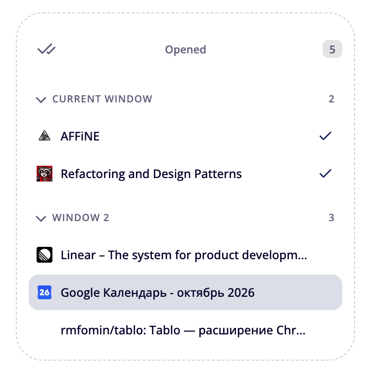

### 2. Поиск по закладкам и недавним страницам

Поиск находит закладки во всех пространствах и недавно посещённые страницы, включая онлайн-документы. Из результатов можно открыть страницу, а кнопка со стрелкой покажет закладку в её папке.

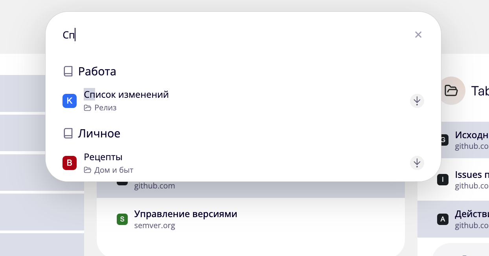

### 3. Группы внутри папок

Объединяйте связанные закладки в группы внутри одной папки. Например, разделите материалы по разработке на Frontend и Backend. Каждую группу можно свернуть, чтобы оставить на виду только нужное.

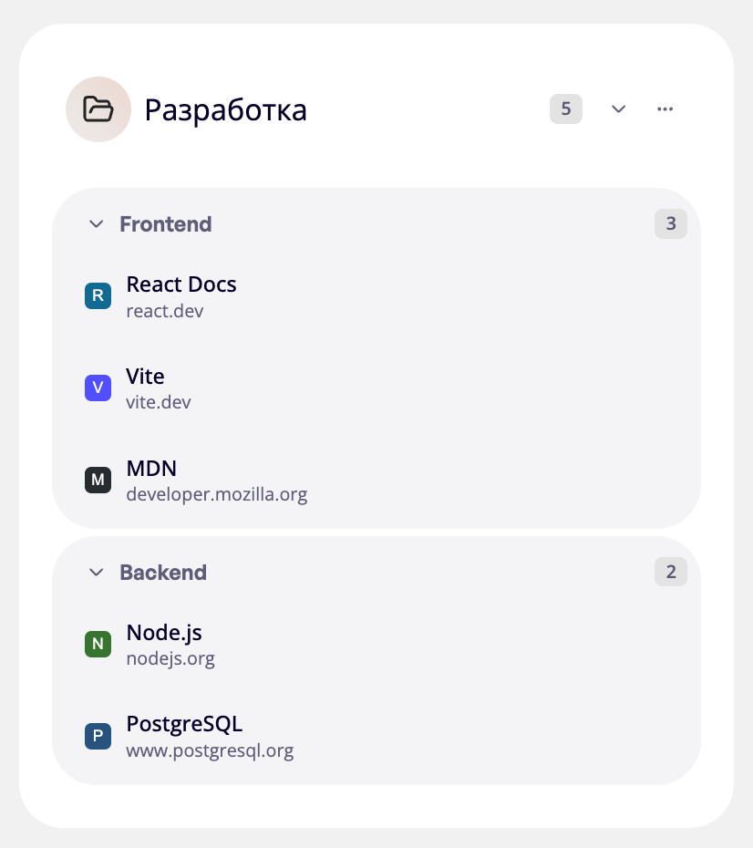

### 4. Действия с папками, группами и закладками

Контекстные меню позволяют создавать, переименовывать, перемещать и удалять элементы. В меню папки также можно открыть все ссылки, свернуть или развернуть группы и перенести папку в другое пространство.

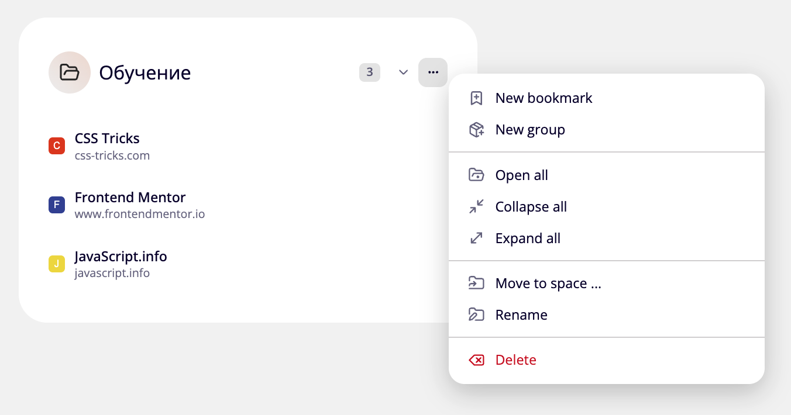

### 5. Название и URL целиком

При редактировании закладки поля названия и URL подстраиваются под длину текста и переносят его на новые строки. Длинный адрес виден целиком, что упрощает проверку и редактирование.

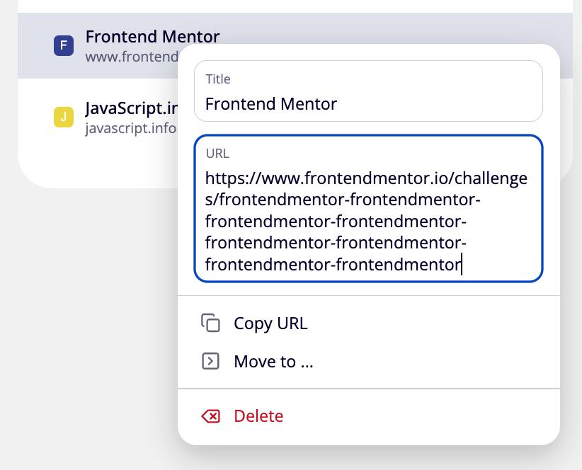

### 6. Наборы сайтов в группах вкладок

Создайте кнопку для набора сайтов и открывайте их сразу в группе вкладок Chrome. В настройках кнопки можно выбрать название и цвет группы, добавить ссылки и изменить их порядок.

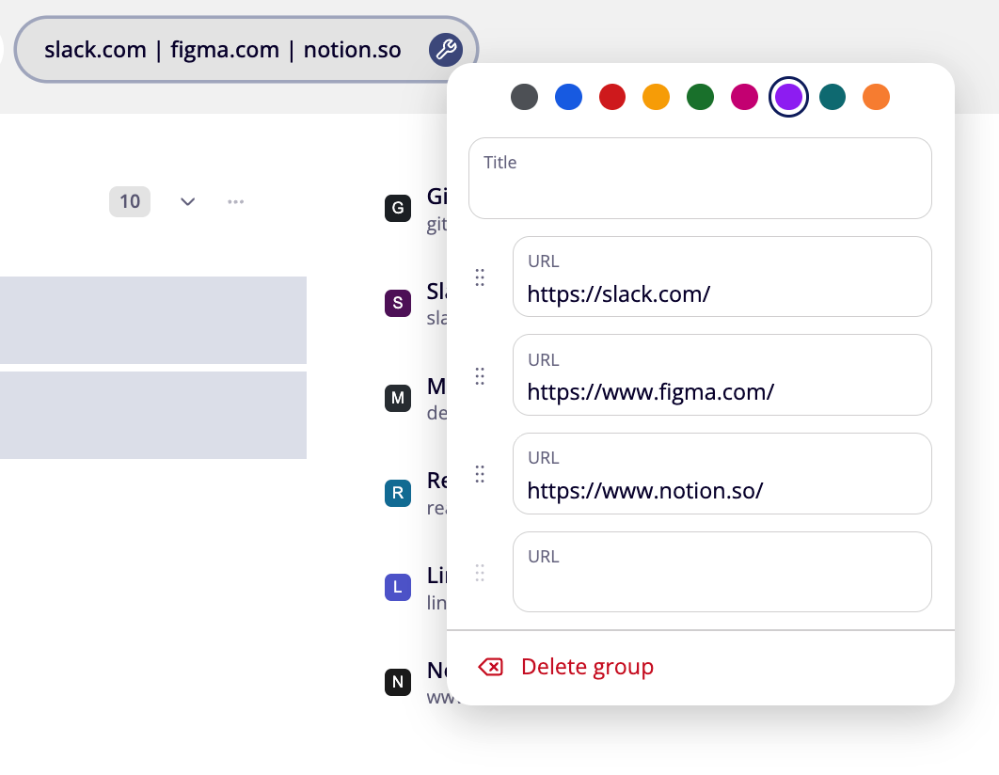

### 7. Полноценный холст

Используйте холст для заметок, схем и визуальных идей. Добавляйте текст, стикеры, фигуры, стрелки и изображения, рисуйте от руки и меняйте масштаб рабочей области.

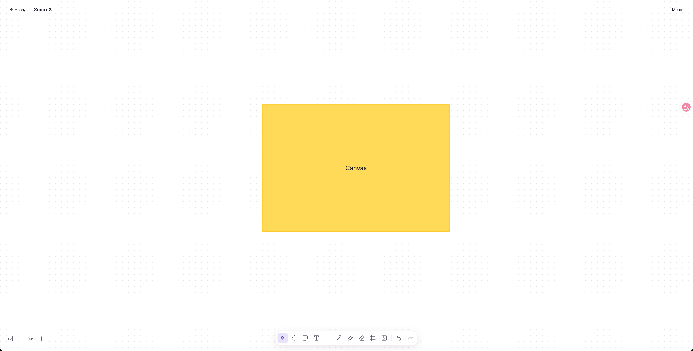

### 8. Настройки интерфейса

Выбирайте тему оформления и способ открытия закладок, включайте всплывающие результаты поиска и фон групп. Выравнивание папок по строкам (**Align folders in rows**) включено по умолчанию. В этом же меню доступны напоминания о резервных копиях, импорт и экспорт.

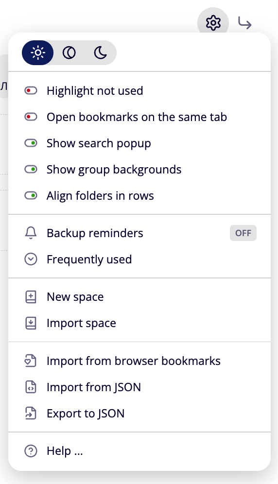

### 9. Отдельные пространства

Разделяйте закладки по задачам: например, создайте пространства «Работа» и «Личное». В каждом пространстве хранится свой набор папок и закладок, а переключение между ними занимает один клик.

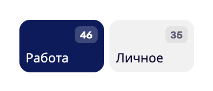

### 10. Выделение нескольких закладок

Выделяйте закладки рамкой, в том числе из разных папок, чтобы выполнять общие действия сразу с несколькими элементами.

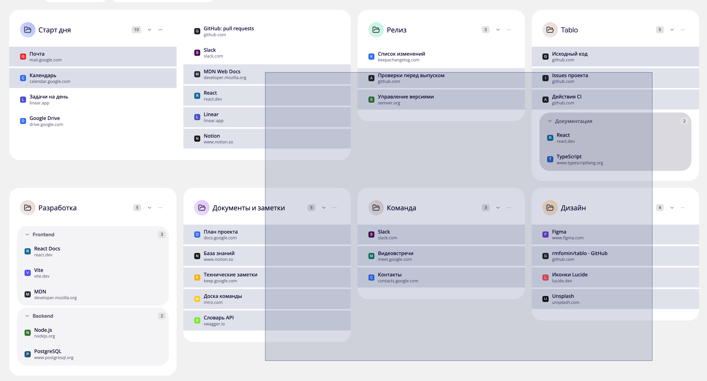

### 11. Папки на несколько колонок

Растягивайте папку на несколько колонок, чтобы разместить больше закладок по ширине экрана. Это удобно для больших подборок, которые хочется видеть целиком.

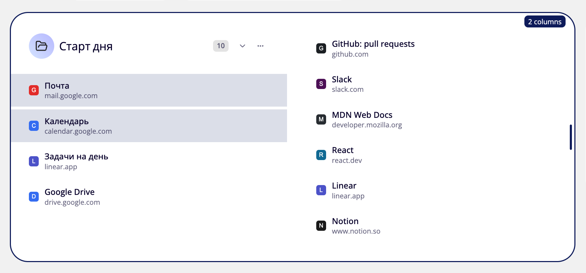

## Установка в Chrome

1. [Скачайте последнюю версию Tablo](https://github.com/rmfomin/tablo/releases/latest/download/tablo-chrome-extension.zip).
2. Распакуйте скачанный ZIP-файл в отдельную папку.
3. Откройте страницу расширений Chrome: [chrome://extensions](chrome://extensions/).
4. Включите **Режим разработчика**.
5. Нажмите **Загрузить распакованное расширение** и выберите папку, в которую распаковали архив.

Откройте новую вкладку, и на ней появится Tablo.
