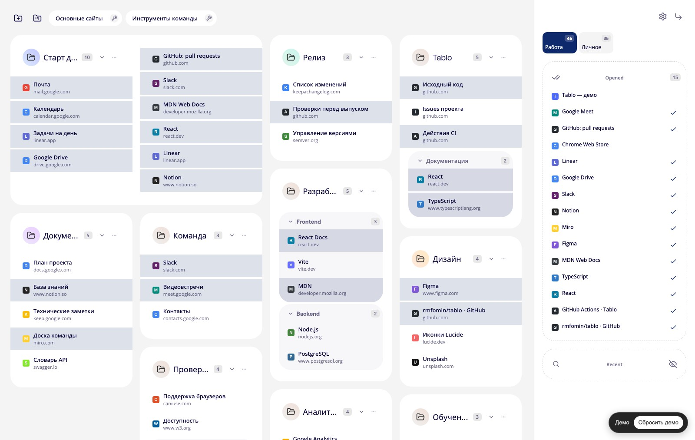
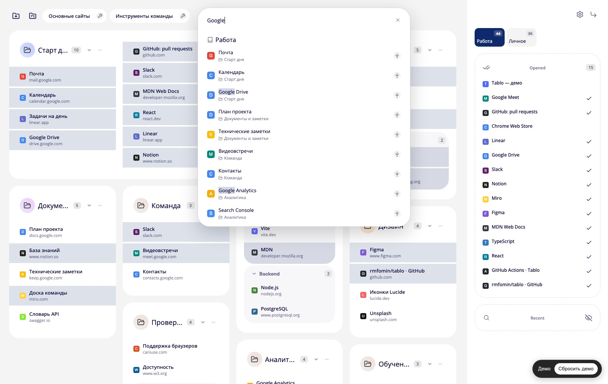
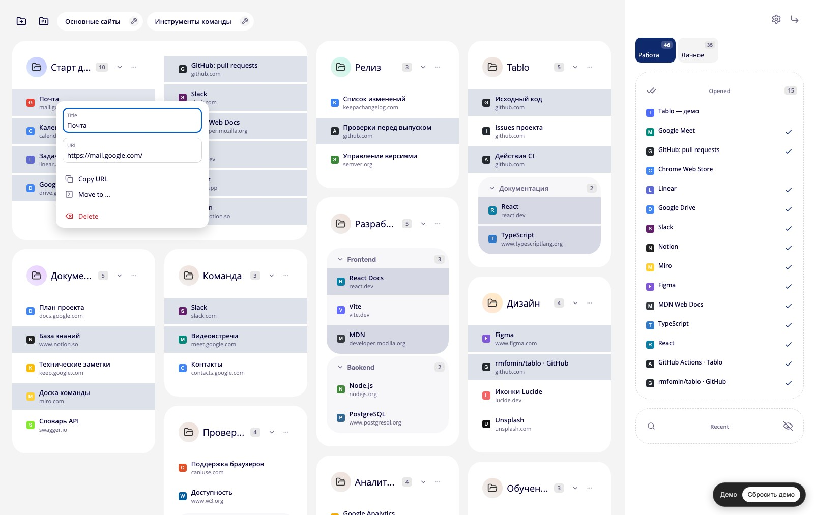

# Tablo

## Что такое Tablo

Tablo — расширение Chrome, которое открывает вашу панель закладок в новой вкладке.

В Tablo можно:

- создавать пространства, папки и группы для закладок;
- перемещать и упорядочивать закладки перетаскиванием;
- искать закладки и выбирать несколько для общих действий;
- просматривать открытые вкладки и недавнюю историю в боковой панели;
- выбирать светлую, тёмную или автоматическую тему;
- создавать и восстанавливать резервные копии;
- отменять последнее изменение.

## Попробовать демо

Посмотрите, как Tablo выглядит в работе: [открыть демо](https://rmfomin.github.io/tablo/). Его можно попробовать прямо в браузере, без установки расширения.

## Установка в Chrome

1. [Скачайте последнюю версию Tablo](https://github.com/rmfomin/tablo/releases/latest/download/tablo-chrome-extension.zip).
2. Распакуйте скачанный ZIP-файл в отдельную папку.
3. Откройте страницу расширений Chrome: [chrome://extensions](chrome://extensions/).
4. Включите **Режим разработчика**.
5. Нажмите **Загрузить распакованное расширение** и выберите папку, в которую распаковали архив.

Готово — откройте новую вкладку, и на ней появится Tablo.
